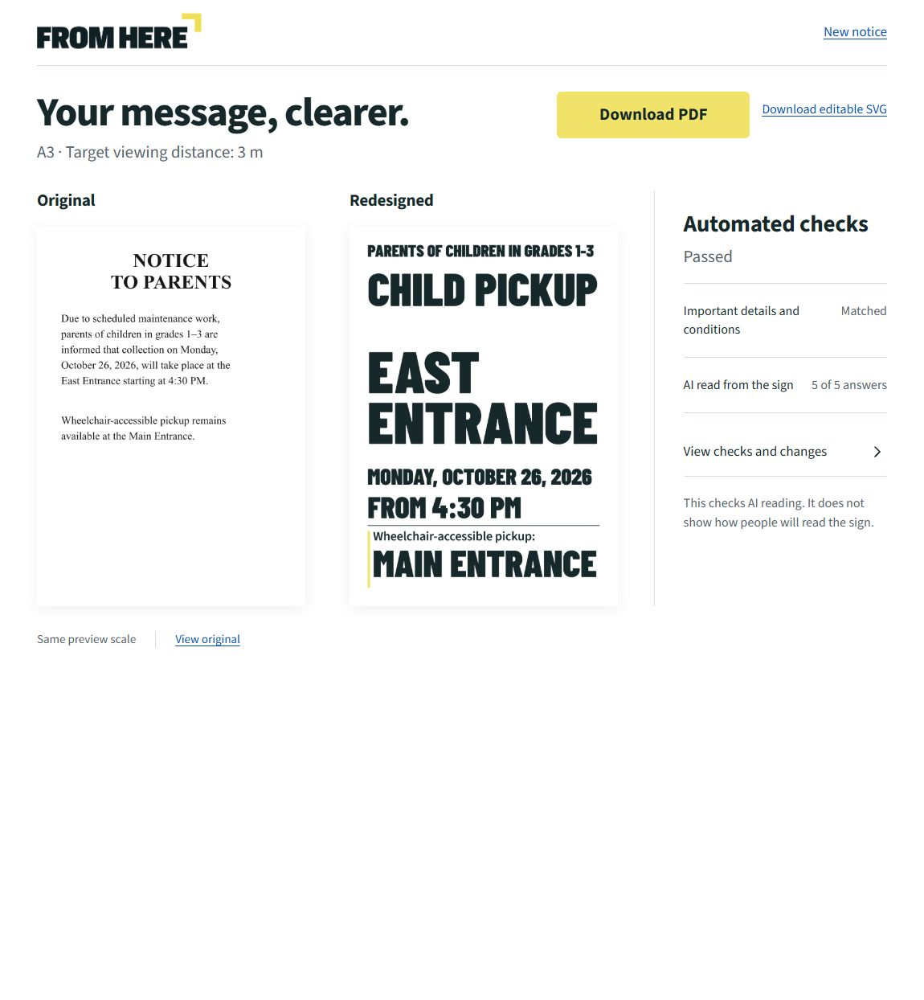

# FROM HERE

Turn a dense English notice photo into a clearer A3 sign while keeping its important details and conditional instructions.

[Product website](https://powers-p1.github.io/from-here/) · [For the jury](https://powers-p1.github.io/from-here/jury/) · [Open the application](https://from-here.onrender.com/)

No installation, account or visitor API key. The responsive web app uses server-side Claude Sonnet 5.5. Its optional [guided walkthrough](https://powers-p1.github.io/from-here/guide/) follows real completed actions through the checked PDF download. The free app host may take about a minute to wake after inactivity; the static product website and saved example remain available separately. Download results before leaving because jobs are temporary.

Upload a PNG/JPG, confirm what it says, compare the original with the generated sign, and download an A3 portrait PDF or editable SVG. A viewing distance of 1, 3 or 5 metres is a design input, not a readability guarantee. The default is 3 metres.

This repository contains the application source and its Docker/Render hosting package. See [public deployment](docs/deployment.md) for the live deployment, verification and service limits.

[Watch the earlier local-model application recording — 1:28](demo/FROM-HERE-demo.mp4). English UI, live local inference, disclosed recording gaps and a scripted optional memory exercise. The current Sonnet integration has [separate live evidence](docs/release-verification.md); its narrated film is being reviewed before publication. This repository copy is for review; the Devpost-required YouTube/Vimeo link is tracked separately.



## How the AI pipeline works

1. The selected vision provider transcribes the actual uploaded image. The current cloud configuration uses Claude Sonnet 5.5 through the Anthropic API.
2. A separate request parses the transcription into audience, action, destination, date/time and a linked conditional instruction. Unreadable and not-stated details remain distinct.
3. The author confirms or edits the facts. Unconfirmed critical details block design.
4. The agent chooses a bounded layout; the renderer creates a real SVG and PNG and measures text fit.
5. A fresh readback transcribes only the rendered sign image. A separate fresh parsing request receives only that transcription and neutral field instructions. Neither request receives the source, confirmed answers, previous attempts or repair feedback.
6. Checks compare the reading with the locked facts. The agent can revise the layout at most twice, then pass or stop. Service interruptions have a separate retry path.

The same SVG supplies preview and export. PDF output is normalized to **297 × 420 mm**. Automatic checks concern AI reading and layout; they do not certify human comprehension or physical reading distance. The optional two-second Glance exercise is a memory exercise; repeats are practice.

## Run locally

Requirements:

- Node.js **24+**, npm and the installed Playwright Chromium browser.
- For the current cloud configuration: an Anthropic API key with available API credit and access to Claude Sonnet 5.5.
- Alternatively, the separately provisioned Qwen vision / Gemma text services described in [model services](docs/model-services.md).

The app runs locally with either cloud or local inference. The current example uses the Anthropic Messages API for every AI role; it needs no local model weights or inference server. Uploaded notice images and text are sent to Anthropic in this profile. Credentials stay on the application server, in `.env.local` or its process environment, and never enter the client bundle. The local profile remains available without a cloud key.

See [model-service setup and tested limits](docs/model-services.md). The validated text service requires suitable GPU hardware; a CPU-only 2B configuration was tried and correctly stopped on lost information. It is not a supported shortcut.

```sh
npm ci
npx playwright install chromium
```

Copy `.env.example` to `.env.local`, preserving any existing local configuration. The app loads `.env.local`, or `.env` if the former is absent. The example selects:

```dotenv
ANTHROPIC_API_KEY=your_anthropic_api_key
AI_PROVIDER=anthropic
AI_BASE_URL=https://api.anthropic.com/v1
AI_MODEL=claude-sonnet-5-5
AI_TIMEOUT_MS=180000
AI_TEXT_PROVIDER=anthropic
AI_TEXT_BASE_URL=https://api.anthropic.com/v1
AI_TEXT_MODEL=claude-sonnet-5-5
PORT=4176
```

```sh
npm run dev
```

Open [FROM HERE locally](http://127.0.0.1:4176). The server binds to `127.0.0.1` by default. [GET /api/health](http://127.0.0.1:4176/api/health) reports the app and selected provider configuration; it does not probe model readiness.

On Windows, `START-FROM-HERE.cmd` installs missing npm/browser dependencies, builds a missing UI and runs the production app in its console. Configure `.env.local` first. Keep that console open; Ctrl+C stops the app.

To serve the built UI locally:

```sh
npm run build
npm start
```

The start command runs TypeScript through the runtime dependency `tsx`; building and running the test suites also requires development dependencies.

## Try it

Choose an English notice with one main instruction, or use the sample button. `public/samples/` contains synthetic notices, including a genuinely obscured-time variant. Samples are inputs to the real pipeline, not stored AI answers. Files must be PNG/JPG, at most 10 MB; server decoding also limits input pixels.

Confirm facts before redesigning. If information is unreadable, supply a confirmed value or choose a clearer photo. Editing invalidates the previous checked result. PDF is primary; a stopped result can only export an explicitly unchecked draft SVG.

Jobs, source buffers and artifacts live in server memory. Jobs more than 60 minutes old are removed by a five-minute cleanup sweep when no task is running; capacity limits can remove an older inactive job sooner. Restarting the server loses them. There are no accounts, database or saved-project library. Download a result you want to keep. Original-image responses allow private browser caching for up to an hour.

## Tests and real inference

```sh
npm run typecheck
npm test
```

Vitest checks contracts, HTTP boundaries and orchestration with deterministic data and mocked provider/tool calls. One regression also exercises the actual Chromium renderer to preserve literal codes. It does not require a live model; it does require the installed browser.

With the local app server already running:

```sh
npm run test:browser
```

The headless browser suite intercepts API responses and uses repository-local recorded data in `tests/fixtures/checked-workshop/`. It needs no AI service. Passing it proves application behavior, not live extraction/readback. Screenshots, reports and traces go outside the repository to `../outputs/from-here/product-qa/browser/`.

For an actual kernel run using the providers selected in `.env.local`:

```sh
node --env-file=.env.local --import tsx scripts/prove-kernel.ts public/samples/community-workshop.png
```

`npm run prove:kernel -- public/samples/community-workshop.png` is also available when the process environment is already configured; that script does not load `.env.local` itself. Leave `USE_RECORDED_EXTRACTION` unset for a fresh source reading. Its explicit recorded-extraction mode is not a fresh end-to-end read.

The proof runs actual inference, rendering, readback and export. It writes source, SVG, PNG, report/receipts and, after passing checks, PDF to `../outputs/from-here/product-qa/kernel/`, replacing previous files there. Set `PROOF_OUTPUT_DIR` to retain a different experiment separately. It exits unsuccessfully on interruption or a stopped check. Its unchanged-fact confirmation is a technical boundary, not a claim of participant interaction.

## Code and licensing

See [architecture](docs/architecture.md) for modules, states, API and isolation details. Original project code is under [MIT](LICENSE), copyright 2026 FROM HERE contributors. Fonts, icons and dependencies retain their own licenses in [third-party notices](THIRD-PARTY-NOTICES.md). External model weights are not included or relicensed by this project.

See [release verification](docs/release-verification.md) for actual test boundaries and selected real artifacts, and the offline [app map](devpost/app-map.html) for a reference route through the code. Public-link and participant-form status is recorded separately in [submission status](devpost/submission-status.md).
