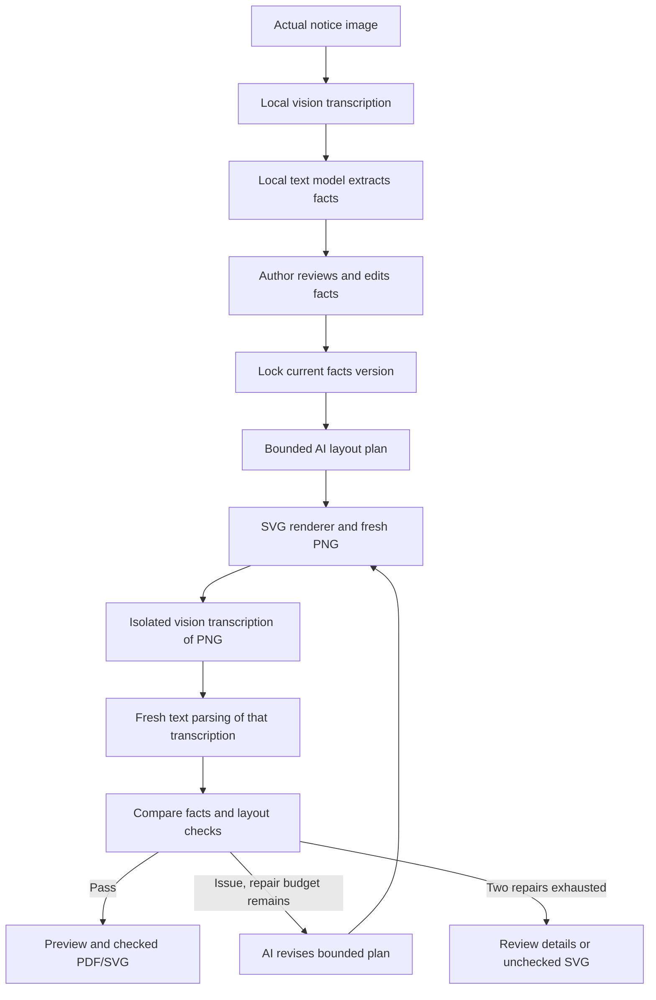

# Architecture

FROM HERE is a React/TypeScript client and a local Express server. Vite supplies development middleware and builds the browser assets. The server owns transient jobs, model requests, rendering and export. It uses no database or authentication service.

## Core flow

Any provider failure can interrupt its current stage. Retry resumes the retained design context; it does not reset the consumed repair budget. Success on the first layout is valid.

## Modules

| Location | Responsibility |
| --- | --- |
| `src/App.tsx` | Compose the current view and overlays; download lifecycle and Glance re-entry state |
| `src/workflow/` | Typed reducer, same-origin API calls, abort controllers, request identities and 600ms polling |
| `src/features/` | Upload, facts/edit, progress/recovery, comparison, checks, dialogs, source viewer and Glance |
| `src/ui/` | Shared controls, native dialogs, typography and responsive tokens |
| `shared/contracts.ts` | Facts, job/report types, JSON schemas, group formatting and blocking rules |
| `server/index.ts` | Environment loading, local HTTP server, Vite/static assets and shutdown |
| `server/api.ts` | Upload/API validation, job commands and checked/draft export boundaries |
| `server/jobs.ts` | In-memory jobs, fact versions, cancellation tokens, retry state and expiration |
| `server/agent/provider.ts` | Ollama and local vLLM JSON adapters, schema validation and request receipts |
| `server/agent/prompts.ts` | Source transcription/parsing, bounded planning and isolated readback |
| `server/agent/pipeline.ts` | Plan/render/read/check loop and at most two completed repairs |
| `server/agent/checks.ts` | Conservative fact comparison, conditional relationships and semantic validation |
| `server/render/renderer.ts` | Real font measurement, escaped SVG, PNG capture and exact A3 PDF |
| `tests/` | Deterministic unit/API tests and separately configured browser regression |
| `scripts/prove-kernel.ts` | Explicit technical exercise of actual local inference and rendering |

## Facts and state

Each audience/action/destination/date/time field has a value and a `known`, `unreadable` or `not_stated` status. Unknown and absent values must be empty, not invented placeholders. The time additionally retains `from`, `at` or `until`. The exception keeps its condition together with the instruction/location that applies under that condition.

Design requires a confirmed main instruction and no blocking unknown fields. `PUT facts` increments `factsVersion`, clears the design context and cached PDF, and returns to review. A design request carries the expected facts version. The server clones those facts for the run.

The public phases are `uploaded`, `reading`, `review`, `planning`, `rendering`, `checking`, `repairing`, `passed`, `stopped` and `interrupted`. Quality failure is `stopped`; service or malformed-response failure is `interrupted`. The latter retains the interrupted phase and design stage (`plan`, `render`, `readback`, `repair` or `done`).

Cancel aborts the active request and advances a server token; late results cannot change the job. It returns to review when facts exist, otherwise uploaded. The client independently aborts stale requests and ignores outdated responses. Modal/source/download dismissal preserves the current opener. A valid replacement is uploaded before the previous job is removed; invalid input preserves existing work.

## Local model requests and isolation

The example routes image transcription to Ollama Qwen3-VL and structured extraction/planning/parsing to local vLLM Gemma. Ollama uses `/api/chat`; vLLM uses `/chat/completions` relative to its `/v1` base. Requests use fresh messages, JSON schemas and temperature zero. Ajv validates returned JSON. The adapter supplies no cloud credential or authorization-header integration.

Source processing has two calls: the actual normalized source image becomes a literal transcript, then a text model parses that transcript. The reader treats image text as data and is told not to reconstruct obscured information.

Readback is a separate two-call path. `read_sign` receives only the newly rendered PNG and a neutral transcription request. `parse_readback` receives only that resulting transcription and generic field instructions. Neither includes the original upload, locked expected values, previous readings, prior history or repair feedback. Isolation means fresh input contexts; it does not imply a separate model installation or human evaluation.

Only after readback does application code compare the observed fields with confirmed facts. Expected known groups determine the report count. An observed extra field is an issue. Date/time comparison allows unambiguous format differences while preserving ranges and time meaning; exceptions compare both condition and instruction.

Planning may receive locked facts and actual check issues so it can repair hierarchy. It returns bounded emphasis, scale, exception scale and margin values, not executable code or rewritten facts. Model receipts record operation, provider/model, duration, token counts, request hash and readback isolation metadata. Receipts are technical provenance, not readability scores.

## Rendering and export

The renderer measures the installed Barlow Condensed and Source Sans 3 fonts in headless Chromium, wraps confirmed text, and creates an SVG with a `297mm × 420mm` size and matching viewBox. Text is XML-escaped. The selected distance influences internal minimum type settings; it remains a design target.

The renderer checks actual glyph bounds against margins and other text and captures that same SVG as a PNG for readback. The server keeps the SVG hash with the report. PDF uses that SVG and embedded fonts, A3 portrait, no external page margin and printed backgrounds. `pdf-lib` normalizes the final page dimensions to exactly 297 × 420 mm after Chromium's physical-unit rounding.

A checked download requires phase `passed`, a passing report and a report hash matching the current sign. PDF creation also checks that the fact version, artifact and phase did not change while export ran. A stopped run may export SVG only with `draft=1`; its filename and interface label say unchecked. A download error preserves the sign and retries export rather than rerunning the agent.

## API

All routes below are under `/api`. Mutations return the current public job unless noted.

| Method and path | Purpose |
| --- | --- |
| `GET /health` | HTTP/configuration information; no model inference or readiness probe |
| `POST /jobs` | Multipart `file` and `distance` (`1`, `3`, `5`); validated PNG/JPG upload |
| `GET /jobs/:id` | Poll public state, current facts, report and history |
| `GET /jobs/:id/source` | Actual original image |
| `POST /jobs/:id/read` | Start source reading in the background |
| `PUT /jobs/:id/facts` | Save `{ facts }`, increment version and invalidate design |
| `POST /jobs/:id/design` | Start/resume design with `{ factsVersion }` |
| `POST /jobs/:id/retry` | Resume a service-interrupted stage |
| `POST /jobs/:id/cancel` | Abort active work, retaining source and existing facts |
| `DELETE /jobs/:id` | Cancel and remove this job; returns 204 |
| `GET /jobs/:id/preview` | Current actual PNG; client includes artifact hash in its query |
| `GET /jobs/:id/sign.svg` | Current SVG preview; availability alone does not imply passed checks |
| `GET /jobs/:id/download?format=pdf\|svg` | Checked artifact; `format=svg&draft=1` permits an explicitly unchecked stopped draft |

Errors are JSON `{ error: string }`. Multer caps uploads at 10 MB; Sharp verifies image signatures/decoding, limits input pixels to 24 million, rotates orientation and normalizes to fit within 1400 × 1800 without enlarging.

## Storage and lifecycle

The process-local Map holds originals, normalized buffers, facts, current artifacts, reports and cached PDF. It is not persisted to disk or a database. A five-minute sweep removes inactive jobs more than 60 minutes after creation; an active job is not expired mid-task. At the 24-job capacity, an older inactive job may be evicted sooner. Deleting/resetting removes the current job. Server restart loses all jobs.

Original responses allow private browser caching for an hour; previews/downloads use no-store. External model processes have their own lifecycle. The app binds locally to `127.0.0.1` unless `HOST` is explicitly overridden. Shutdown aborts job requests and closes the renderer browser and Vite middleware.

## Verification boundaries

`npm test` uses deterministic facts and mocked model/tool/HTTP-provider responses, plus an actual Chromium renderer regression for literal preservation. `npm run test:browser` needs a running local app server but intercepts its API calls; repository-local recorded workshop output is mock fixture data, with provenance documented beside it. Neither suite proves live inference.

The kernel script uses actual local services by default. It keeps the extracted facts unchanged at its explicit technical confirmation boundary, writes receipts/artifacts outside the repository, and exits unsuccessfully on failure. Its optional recorded-extraction mode is labeled in the report and must not be described as a fresh source read.

Glance keeps countdown/exposure separate from the question, removes the sign before asking, clears timers on exit and labels repeats as practice. It is optional screen-based recall, not a certification or an update to the automatic check status. Human comprehension, physical print readability, hosting and public availability require separate evidence.
